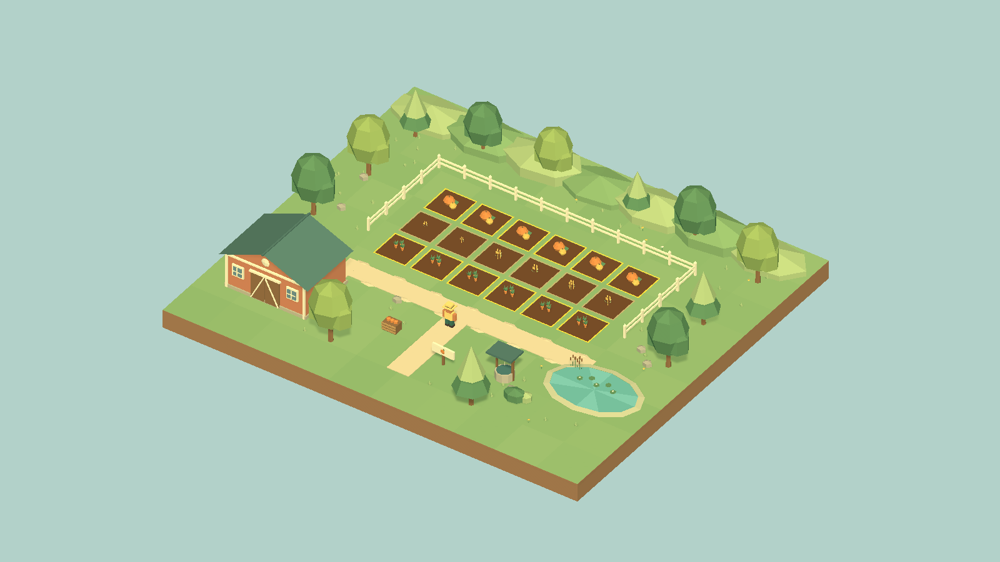
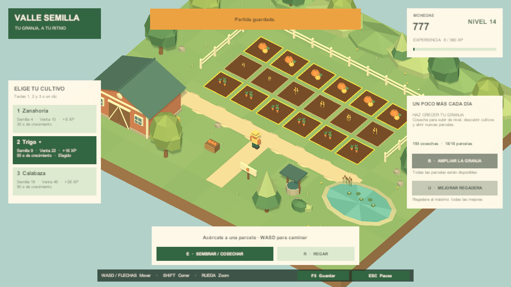

# Valle Semilla

**Tu granja, a tu ritmo.**

Valle Semilla es un prototipo de juego de **farmeo y progresión para PC**, desarrollado en **Unity 6.3 LTS** con estética **low poly** y cámara isométrica. Empiezas con una pequeña parcela de tierra, unas pocas monedas y semillas de zanahoria. Cada cosecha te permite ampliar la granja, mejorar la regadera y desbloquear nuevos cultivos.

La experiencia se centra en cuidar lo que plantas y ver crecer tu granja: caminar entre los bancales, sembrar, regar y decidir en qué invertir las ganancias de la siguiente cosecha.

*Render del prototipo en Unity. Vista general con la interfaz oculta para mostrar el escenario.*

| Característica | Descripción |
| --- | --- |
| Género | Farmeo, gestión sencilla y progresión |
| Plataforma actual | Windows de 64 bits |
| Jugadores | Un jugador, partida local |
| Estilo visual | Low poly, colores cálidos y cámara isométrica con zoom |
| Motor | Unity 6000.3.26f1 · Built-in Render Pipeline |
| Idioma | Español |
| Estado | Prototipo jugable |

## ¿Cómo se juega?

Empiezas con **30 monedas y 6 parcelas disponibles**. Acércate a una parcela vacía y elige qué cultivar. Las semillas cuestan monedas; al cosechar, la venta es automática y recibes dinero y experiencia.

1. **Siembra:** invierte parte de tus monedas en un cultivo.
2. **Riega:** acelera su crecimiento para recogerlo antes.
3. **Cosecha:** recibe monedas y experiencia cuando esté maduro.
4. **Mejora:** compra más parcelas, mejora la regadera y desbloquea cultivos al subir de nivel.

El objetivo del prototipo es desarrollar una granja de **18 parcelas**, desbloquear sus **tres cultivos** y avanzar en las **cinco mejoras de regadera**. Tú eliges el ritmo y el orden de tus inversiones.

*Captura del juego con su interfaz: selección de semillas a la izquierda, progreso a la derecha y acciones en la parte inferior.*

## Un pequeño valle para cultivar

La granja ocupa un diorama con granero, árboles facetados, cercas, caminos, estanque, flores y rocas. El personaje se mueve libremente por el entorno y la cámara lo sigue con una vista isométrica.

Las parcelas muestran su estado con bordes de color: el contorno amarillo señala la parcela cercana, el azul indica riego y el dorado una cosecha lista. La interfaz reúne las monedas, el nivel, la experiencia y las próximas mejoras.

## Cultivos y progresión

| Cultivo | Se desbloquea | Coste de semilla | Venta automática | Experiencia | Crecimiento sin riego |
| --- | --- | ---: | ---: | ---: | ---: |
| Zanahoria | Nivel 1 | 4 monedas | 10 monedas | 8 XP | 30 segundos |
| Trigo | Nivel 2 | 9 monedas | 22 monedas | 16 XP | 55 segundos |
| Calabaza | Nivel 3 | 18 monedas | 46 monedas | 28 XP | 90 segundos |

- **Más terreno:** amplía de 6 a 18 parcelas. La primera ampliación cuesta 35 monedas; las siguientes aumentan 20 monedas cada una.
- **Mejor riego:** regar acelera el crecimiento a 1,5×. Cada mejora añade 0,25×; la primera cuesta 60 monedas.
- **Nuevos cultivos:** alcanza 40 XP para llegar al nivel 2 y 120 XP para llegar al nivel 3.
- **Partida persistente:** guardado manual y automático cada 30 segundos, al perder el foco y al salir.

El crecimiento se detiene al pausar, perder el foco o cerrar el juego. No hay progreso de cultivos mientras el juego está cerrado.

## Controles

| Acción | Tecla o entrada |
| --- | --- |
| Mover al personaje | WASD o flechas |
| Correr | Shift |
| Acercar o alejar la cámara | Rueda del ratón |
| Elegir cultivo | 1, 2, 3 o botones de la interfaz |
| Sembrar / cosechar la parcela cercana | E |
| Regar la parcela cercana | R |
| Comprar la siguiente parcela | B |
| Mejorar la regadera | U |
| Guardar la partida | F5 |
| Pausar / continuar | Esc |
| Cerrar el juego | Alt+F4 |

## Jugar o abrir el proyecto

**Para jugar en este equipo:** abre `Builds/Windows/ValleSemilla.exe`. Mantén junto al ejecutable todas las carpetas y archivos que lo acompañan. El build se genera localmente y no se incluye en el repositorio.

**Para editar en Unity:** abre esta carpeta como proyecto con **Unity 6000.3.26f1**, carga `Assets/FarmGame/Scenes/Farm.unity` y pulsa **Play**. También puedes usar `Tools/Open-Unity.ps1` desde PowerShell.

Si la escena todavía no está generada, utiliza **Valle Semilla → Preparar escena inicial**. Para crear el ejecutable, utiliza **Valle Semilla → Compilar para Windows**.

## Diseñado como una base ligera

El escenario utiliza colores por vértice y cinco mallas de decorado con un material compartido. Los cultivos reutilizan objetos, el crecimiento se calcula con un reloj central y la iluminación emplea una sola luz direccional, sin posprocesado.

La escena validada tiene **4.790 triángulos de entorno**, incluida la vista previa de parcelas de edición. El juego tiene un límite configurado de **60 FPS**; todavía falta medir su rendimiento en el equipo objetivo.

## Estado del proyecto

Están implementados el entorno, el personaje, la siembra, el riego, la cosecha, la economía, los niveles, las ampliaciones, las mejoras y el guardado local. Se aprobaron **225 comprobaciones del modelo**, la validación de arranque en Unity y la compilación para Windows.

Es una base para seguir desarrollando. Animales, construcción libre, inventario independiente, audio, controles de mando y multijugador todavía no están implementados. Queda pendiente una prueba manual completa de controles y rendimiento.

Consulta la [guía de desarrollo](docs/DESARROLLO.md) para instalación, arquitectura, guardado y validación, o el [mapa del proyecto](PROJECT_MAP.md) para localizar los componentes.

Las imágenes de este README son renders del prototipo y se guardan en `docs/images/`.
